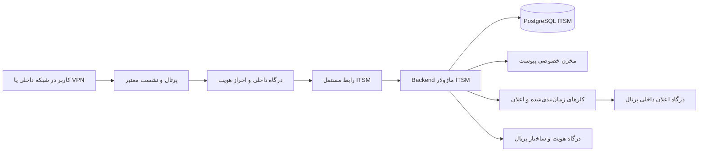

# سند معماری فنی سامانه ITSM

نسخه: ۰٫۱ پیشنهادی برای بررسی — ۱۴۰۵/۰۸/۲۳

## ۱. وضعیت و دامنه

کارفرما ساخت سامانه اختصاصی الهام‌گرفته از ServiceDesk Plus را تأیید کرده است؛ انتخاب فناوری و راه اتصال پیشنهادی‌اند و نیازمند تأیید هستند. نیازمندی‌ها و تصمیم‌های باز در `itsm-srs.md` مرجع‌اند. طراحی تفصیلی، ایجاد سرویس، صفحه، API یا تغییر داده با این سند انجام نشده است.

## ۲. وضعیت واقعی پرتال

- رابط موجود Next.js/React/TypeScript، پایگاه PostgreSQL و Prisma است؛ مسیر `/tickets` فعلاً «به‌زودی» نمایش می‌دهد. کارت اصلی و منو از قبل مسیر پیشنهادی دارند اما محصول عملیاتی نیست.
- `Employee.id` عددی پایدار و `Employee.code` یکتا و قابل تغییر است؛ فیلدهای واحد، محل، سمت، مدیر مستقیم، موبایل و ایمیل موجودند و بعضی اختیاری‌اند. وجود فیلدها به معنی کامل‌بودن داده‌ها نیست.
- نشست پرتال با کوکی و رکورد `Session` بررسی می‌شود؛ `currentUser()` کاربر فعال را از پایگاه می‌خواند. `middleware` تنها وجود کوکی را می‌سنجد، نه اعتبار نشست را؛ API جدید باید مستقل از آن مجوز را بررسی کند.
- نقش فعلی یک رشته روی کارمند است و `admin` مجوز `*` دارد. نقش چندگانه، استثناهای فردی، دامنه گروه و جداسازی مدیر سامانه از مدیر IT برای ITSM هنوز وجود ندارند. `/api/auth/me` API محدودشده هویتی یا پروتکل SSO کامل نیست.
- مطابق `location-scope.md` دامنه محلی پرتال باید رعایت شود. دسترسی چندمحلی کارشناسان IT نیازمند مجوز مشخص و استثنای مصوب است، نه حدس از نام محل.

## ۳. تصمیم پیشنهادی فناوری

| معیار | Django/Python | NestJS/Node.js |
|---|---|---|
| هماهنگی با پرتال | اتصال از API ممکن، زبان و زنجیره ابزار متفاوت | TypeScript مشترک با رابط و پرتال |
| PostgreSQL/تراکنش/امنیت | پشتیبانی مناسب؛ کنترل دامنه باید طراحی شود | پشتیبانی مناسب؛ کنترل دامنه باید طراحی شود |
| نگهداری و گردش کار | تجربه تیم طبق درخواست مشابه؛ اکوسیستم متفاوت | تجربه تیم مشابه؛ اشتراک مدل‌های API و تایپ‌ها |
| استقرار روی Windows | قابل اجرا با ابزار استقرار مناسب | قابل اجرا با ابزار استقرار مناسب |

**پیشنهاد:** NestJS/TypeScript برای Backend ماژولار، React/TypeScript برای رابط مستقل و PostgreSQL؛ ترجیح هماهنگی فنی است، نه ادعای برتری ذاتی عملکرد یا امنیت. نسخه‌ها، ORM و ابزار اجرا پس از بررسی پشتیبانی، تجربه تیم و تست روی سرور تعیین شوند؛ Prisma موجود گزینه نخست بررسی است. ساختار Modular Monolith، نه چند سرویس مستقل، برای نیاز فعلی پیشنهاد می‌شود.

## ۴. طرح کلان پیشنهادی

پیشنهاد استقرار رابط و API زیر دامنه/مسیر قابل کنترل در همان مبدأ و شبکه داخلی، با پوسته و منوی اختصاصی ITSM است. پیوند `/tickets` پس از تأیید معماری به رابط منتقل می‌شود. دامنه، reverse proxy، گواهی و روش محدودسازی VPN نیازمند بررسی سرور واقعی‌اند. پیاده‌سازی پشت‌صحنه همچنان یک استقرار منطقی ماژولار است؛ Worker در صورت نیاز می‌تواند فرایند مجزا از همان کد باشد، نه میکروسرویس مستقل.

## ۵. احراز هویت، داده مرجع و اتصال

۱. مرجع هویت پرتال می‌ماند؛ شناسه داخلی پایدار `Employee.id` یا شناسه جایگزین غیرقابل تغییر برای ارتباط و کد پرسنلی به‌عنوان شناسه تجاری قابل تغییر نگهداری شود. این پیشنهاد تناقض «شناسه کد پرسنلی» و تغییر آن بدون گم‌شدن سابقه را حل می‌کند و نیازمند تأیید است.
۲. در همان مبدأ، الگوی پیشنهادی BFF است: درگاه پرتال نشست واقعی را در سرور اعتبارسنجی کند و با تبادل کوتاه‌عمر و محدود به مخاطب، هویت را به API داخلی منتقل کند. API توکن امضاشده، مهلت، صادرکننده و مخاطب را بررسی کند؛ از انتقال رمز، نشانه دائمی یا اتکای صرف به وجود کوکی پرهیز شود. قرارداد دقیق SSO پس از تأیید زیرساخت و تهدیدسنجی نهایی شود.
۳. API اختصاصی حداقلی سروربه‌سرور با سطح دسترسی برای شناسه، کد، نام، وضعیت، واحد، سمت، محل و مدیر ارائه شود؛ موبایل/ایمیل فقط در صورت نیاز. انتقال افزایشی، نسخه و زمان آخرین همگام‌سازی، خطا و بازاجرای امن لازم است. اطلاعات تاریخی عملیاتی باید با تغییر پرسنل حفظ شوند.
۴. در هنگام ورود، وضعیت فعال بررسی شود؛ در قطع پرتال یا همگام‌سازی، سیاست توقف/مهلت و حداکثر تأخیر قطع دسترسی تصمیم باز است. تغییر کد، انتقال، پایان همکاری و تخصیص‌های فعال باید به‌صورت آزمودنی پوشش داده شوند.
۵. اعلان داخلی با قرارداد idempotent به درگاه اعلان پرتال ارائه شود؛ چنین درگاهی در وضعیت فعلی تأیید نشده و باید در طرح اجرا ایجاد و آزمون شود. مشخصات کامل فرد در اعلان درج نشود.

## ۶. ماژول‌ها و مرز مسئولیت

| ماژول | مسئولیت | وابستگی اصلی |
|---|---|---|
| Identity Integration | نشست، شناسه و همگام‌سازی پرتال | پرتال |
| Access & Organization | نقش، مجوز فردی، گروه، عضویت، قلمرو و نمایندگی | Identity |
| Catalog & Workflow | نوع خدمت، اولویت، وضعیت استاندارد/محلی و دلایل | Access |
| Tickets | ثبت، جزئیات، ارتباط، مکاتبه و پیوست | Access, Catalog |
| Assignment & Routing | تخصیص، انتقال گروهی، رد و تأیید | Tickets, Access |
| SLA & Calendar | تقویم کاری، دو ساعت SLA، توقف، هشدار و سوابق | Tickets, Catalog |
| Assets & Inventory | دارایی، انبار، رسید، گردش و تعمیر | Access, Tickets |
| Notifications | اعلان داخلی و تحویل قابل تکرار | همه رویدادهای مجاز، پرتال |
| Reporting | گزارش و خروجی محدود به قلمرو | همه ماژول‌ها |
| Audit & Files | نسخه، ثبت وقایع و دسترسی امن پیوست | همه ماژول‌ها |

وابستگی‌ها از طریق سرویس‌ها/رویدادهای داخلی مشخص شوند؛ ماژول‌ها از جدول داخلی یکدیگر مستقیماً تغییر ندهند. تغییر تیکت، تاریخچه و رویداد اعلان در یک تراکنش ثبت و تحویل بیرونی با outbox و کلید یکتا پس از commit انجام شود.

مدیر فناوری اطلاعات نگاشت دسته‌بندی به واحد رسیدگی را مدیریت می‌کند؛ ثبت تیکت باید این نگاشت را سمت سرور اعمال کند و تیکت را در صف مشترک واحد قرار دهد. برداشت از صف و تغییر مسئول باید با کنترل مجوز و به‌صورت اتمی انجام شود. رفتار تغییر نگاشت برای تیکت‌های قبلی و نبود واحد همچنان نیازمند تصمیم است.

## ۷. مدل داده مفهومی

| حوزه | موجودیت‌های پیشنهادی و قیود |
|---|---|
| هویت/دسترسی | `PortalUserRef` با شناسه پایدار و کد فعلی؛ `ITGroup`, `GroupMembership`, `Role`, `Permission`, `UserGrant`, `Delegation` با دامنه و بازه اعتبار |
| تیکت | `Ticket`, `TicketLink` با حداکثر یک پیوند پیشین، `TicketEvent`, `Message`, `MessageRevision`, `Attachment`; شماره یکتا، وضعیت نهایی و محدودیت قلمرو |
| ارجاع | `Assignment`, `TransferRequest`, `Reason`, `AssignmentHistory` با وضعیت تصمیم، عامل و زمان؛ صف مشترک و برداشت اتمی برای جلوگیری از تصاحب هم‌زمان |
| SLA | `WorkCalendar`, `Workday`, `Holiday`, `PriorityPolicy`, `SlaInstance`, `SlaEvent` و نسخه سیاست؛ دو هدف پاسخ/حل مستقل |
| دارایی/انبار | `AssetCategory`, `Asset`, `AssetAssignment`, `Warehouse`, `WarehouseManager`, `InventoryItem`, `InventoryMovement`, `TransferDocument`, `RepairRecord`; کد یکتا، شمارش و وضعیت ثابت |
| خروجی و ثبت | `AuditEvent`, `OutboxEvent`, `NotificationDelivery`, `SavedReport`, `ReportRun` با قلمرو و تاریخ ایجاد |

کلیدهای خارجی، unique، check constraint و index برای شناسه، مالک، گروه، محل، وضعیت و زمان طراحی و با migration نسخه‌بندی شوند. از جدول عمومی `Setting` برای تراکنش‌های تیکت/انبار استفاده نشود. جزئیات ERD، نگهداری تاریخی محل، حذف اشخاص و نگهداری فایل نیازمند طراحی تفصیلی‌اند.

## ۸. قراردادهای API پیشنهادی

نسخه‌بندی `/api/itsm/v1` و JSON؛ هر عملیات شامل احراز هویت، مجوز دامنه و اعتبارسنجی سمت سرور، شناسه درخواست و خطای فارسی قابل فهم است. فهرست‌ها pagination، مرتب‌سازی مجاز و فیلتر مجاز دارند؛ جزئیات حساس در log ثبت نشوند.

| نمونه مسیر | هدف |
|---|---|
| `GET /me`, `GET /permissions` | هویت و مجوزهای مؤثر |
| `GET/POST /tickets`, `GET /tickets/{id}` | فهرست/ثبت و جزئیات در قلمرو |
| `GET /tickets/queue`, `POST /tickets/{id}/claim` | صف مشترک مجاز و برداشت اتمی توسط کارشناس واجد شرایط |
| `POST /tickets/{id}/transitions`, `/messages`, `/transfers`, `/assignment-requests` | عملیات مشخص با دلیل و کنترل وضعیت |
| `GET /tickets/{id}/attachments/{fileId}` | دریافت فایل پس از کنترل مجوز همان تیکت |
| `GET/POST /assets`, `/warehouses`, `/inventory/movements` | عملیات دارایی و انبار مطابق نقش |
| `GET /reports`, `POST /reports/runs` | گزارش و خروجی محدودشده |
| قرارداد داخلی `/identity-sync` و `/notifications` | همگام‌سازی و اعلان، فقط سرویس مجاز |

این‌ها قرارداد نهایی یا مسیرهای موجود نیستند. رفتار `400/401/403/404/409/422`، کلید idempotency عملیات نوشتن، محدودیت نرخ و صفحه‌بندی در طراحی تفصیلی مستند شوند. شناسه قابل حدس هرگز جایگزین مجوز نیست.

## ۹. محاسبات و یکپارچگی

- زمان‌ها UTC و منطقه محاسبه `Asia/Tehran`؛ مبدأ تقویم کاری مستقل از کارت عمومی تقویم است و تعطیلات دستی مدیر IT، نه داده عمومی ناقص یا خودکار، مبنای SLA است.
- ساعت کاری پاسخ و حل به‌صورت نمونه سیاست زمان‌دار و رویدادهای شروع/توقف/ادامه نگهداری شود. تغییر اولویت، تعطیلی و پاسخ پس از حل بر اساس تصمیم‌های D05 و D06 نهایی شود؛ هیچ قاعده پنهانی بر داده تاریخی اعمال نشود.
- تخصیص هم‌زمان، لغو/بستن و انتقال انبار با تراکنش و قفل یا کنترل نسخه؛ no-negative با استثنای تأییدشده مدیر و مسیر حسابرسی. عملیات گروهی نتیجه هر ردیف را ثبت می‌کند؛ اتمی‌بودن کل دسته تصمیم باز است.
- worker پایدار کارهای هشدار SLA، همگام‌سازی، اعلان و گزارش زمان‌بندی‌شده را با قفل، idempotency، retry محدود و هشدار شکست اجرا می‌کند. وابستگی scheduler به اجرای مرورگر مجاز نیست.

## ۱۰. امنیت، فایل و ممیزی

مجوز مؤثر شامل نقش، اعطای فردی، قلمرو، وضعیت حساب و ارتباط با رکورد است؛ wildcard فعلی پرتال به‌طور خودکار مجوز محتوای ITSM نمی‌دهد. نیاز به نسخه تاریخی برای مدیر سامانه با محرمانگی عملیاتی مطابق D08 تعیین شود.

پیوست خارج از مسیر عمومی، با نام تصادفی، محدودیت اندازه/نوع، بررسی محتوا و در صورت فراهم‌بودن ضدبدافزار؛ دانلود پس از کنترل دسترسی و با هدر امن. سیاست دقیق حجم، قالب و اسکن پیش از بهره‌برداری تأیید شود. گزارش و فایل‌های زمان‌بندی‌شده نیز محدود به مجوز و دارای سیاست انقضا باشند.

تاریخچه پیام و رویداد افزایشی، مجوز محدود نوشتن/حذف و ثبت عامل/زمان/دلیل؛ حفاظت از تغییر توسط مدیر پایگاه با کپی مستقل، رویه بررسی و ترجیحاً ذخیره ضددستکاری در زیرساخت پشتیبان بررسی شود. عدم دستکاری مطلق صرفاً با جدول پایگاه تضمین نمی‌شود.

## ۱۱. استقرار، عملیات و آزمون

اجرای سرویس‌ها روی Windows Server با حساب سرویس کم‌اختیار، reverse proxy/TLS، محدودسازی شبکه/VPN، نگهداری امن اسرار، ثبت ساختاریافته و مانیتورینگ خطا و صف؛ سازوکار دقیق service manager و سطح دسترسی بر اساس زیرساخت واقعی تصمیم‌گیری شود. نسخه پشتیبان سازگار از پایگاه، پیوست و پیکربندی همراه با آزمون بازیابی، زمان‌بندی و اهداف تأییدشده لازم است.

یک محیط عملیاتی خواسته شده، اما تست با اطلاعات واقعی یا تغییر مخرب روی آن پذیرفتنی نیست؛ یک محیط/پایگاه آزمون جداگانه یا روش ایزوله با تأیید کارفرما لازم است. آزمون‌های اجباری: مجوز/قلمرو، نشست نامعتبر، شناسه تغییرکرده و حساب غیرفعال؛ گذارهای مجاز و غیرمجاز؛ هم‌زمانی و rollback؛ SLA و تعطیلات؛ پیوست، XLSX/PDF، کارهای تکراری و بازیابی. زمان‌بندی و معیارهای عددی در قرارداد پذیرش تعیین می‌شوند.

## ۱۲. ریسک‌ها و تصمیم‌های باز

عدم وجود SSO/اعلان مناسب در پرتال، مجوز `admin` فعلی، نامشخص‌بودن قواعد D02–D12، قابلیت بازیابی داده، نبود محیط تست مجزا و ظرفیت تیم/سرور از ریسک‌های اصلی‌اند.
