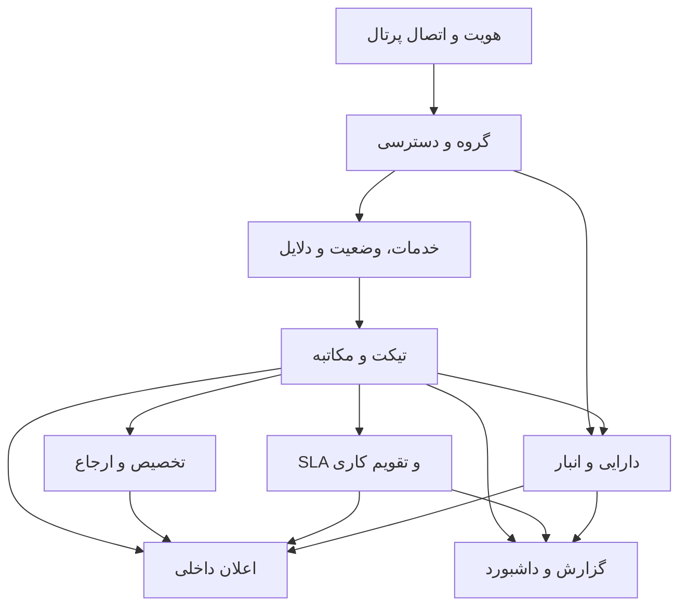

# نقشه راه و ساختار ماژول‌های ITSM

نسخه: ۰٫۱ برای بررسی — ۱۴۰۵/۰۸/۲۳

## اصول

کارفرما ساخت اختصاصی مشابه ManageEngine را تأیید کرده است. فازها پس از تأیید اسناد و با اولویت و ظرفیت واقعی تیم زمان‌بندی می‌شوند. عدد زمان/هزینه یا تاریخ تحویل بدون برآورد داده نمی‌شود. هر مرحله طراحی، پیاده‌سازی، آزمون و مستندات خود را دارد؛ انتشار عملیاتی جداگانه نیازمند تأیید است.

## وابستگی ماژول‌ها



فایل و ممیزی زیرساخت مشترک در مراحل آغازین‌اند. اتصال دارایی به تیکت در زمان آماده‌شدن هر دو فعال می‌شود، اما نسخه اولیه تیکت را نباید به تکمیل همه انبار وابسته کرد.

## مراحل پیشنهادی و دروازه پذیرش

| مرحله | خروجی و نیازمندی‌های اصلی | شرط عبور |
|---|---|---|
| ۰. تحلیل و تصمیم | سه سند SRS، معماری و نقشه راه؛ رفع D01–D12 مرتبط با شروع، تأیید دامنه و محصول | تأیید مکتوب کارفرما برای شروع طراحی؛ تصمیم‌های بعدی مشخص و مالک‌دار |
| ۱. طراحی UX/UI | ساختار مستقل، مسیرها و منوی نقش‌محور؛ طراحی داشبوردها، فهرست، ثبت/جزئیات، حالت‌های خالی/خطا، موبایل و روشن/تاریک؛ سازگار هویت برند | بازبینی نمونه تعاملی با کارمند، کارشناس و رئیس؛ بدون دستکاری طراحی تأییدشده پرتال |
| ۲. پایه و هویت | پیوند کنترل‌شده به پرتال، نشست واقعی، شناسه پایدار، دریافت و همگام‌سازی، گروه/عضویت و نقش/دامنه، مجوز فردی، زیرساخت ممیزی و فایل؛ FR-01–03 | آزمون ورود/خروج/غیرفعال‌سازی، تغییر کد، نبود محل، دسترسی نادرست و بازیابی؛ تأیید قرارداد SSO |
| ۳. چرخه تیکت | FR-04–10، فرم، کارتابل شخصی و کارشناس، مکاتبه عمومی/داخلی، لغو و بسته، ارتباط یک تیکت، اعلان پایه | آزمون همه گذارهای مجاز/نامجاز، محرمانگی یادداشت، پیوست و سطوح دسترسی، عدم بازگشایی |
| ۴. تخصیص و ارجاع | FR-11–14 و اعلان‌های مربوط؛ تنظیم دسته‌بندی و واحد توسط مدیر IT، هدایت خودکار به صف واحد و برداشت توسط کارشناس، قواعد گروه/محل، رد و تغییر مسئول | آزمون نگاشت و هدایت، برداشت هم‌زمان، مسئول غیرفعال، مقصد/مبدأ و نتیجه هر ردیف؛ تأیید رؤسای IT |
| ۵. SLA و تقویم کاری | FR-15–19، سیاست‌ها، دو ساعت، وقفه، تغییر اولویت، هشدار/نقض و کار زمان‌بندی | آزمون ساعت کاری، مرز شب، تعطیلی، انتظار چندباره، تغییر اولویت، ارجاع، ازکارافتادن و اجرای مجدد worker؛ تطبیق با نمونه‌های مورد تأیید |
| ۶. دارایی و انبار | FR-20–27، دسته، انبار، تحویل/عودت، انتقال، تعمیر، اسقاط، اقلام مصرفی، ورود Excel/API و حداقل موجودی | آزمون موجودی و هم‌زمانی، دسترسی به دارایی شخصی، مستندات انتقال و repair، خطای ورودی و تأییدها |
| ۷. گزارش و داشبورد | FR-28–30، اعلان در پرتال، داشبوردهای نقش‌محور، گزارش‌ساز و خروجی/زمان‌بندی | تطابق با داده مرجع و قلمرو هر نقش، فایل فارسی Excel/PDF، تغییر مجوز پس از زمان‌بندی، عدم اعلان تکراری |
| ۸. پذیرش و راه‌اندازی | آزمایش یکپارچه، امنیت، بازیابی، عملکرد و آموزش؛ راه‌اندازی محدود و سپس توسعه تدریجی | تأیید فنی تیم داخلی، تأیید عملکردی نمایندگان پنج گروه، تأیید بهره‌برداری و امکان بازگشت |
| ۹. تحویل و نگهداری | تحویل کد، نسخه‌گذاری، API، ERD، استقرار، بکاپ/بازیابی و راهنمای چهار نقش | آزمون نصب و بازیابی توسط تیم داخلی و تحویل مستندات |

مراحل ۳ تا ۵ به یکدیگر وابسته‌اند؛ بهره‌برداری تیکت بدون SLA فقط در صورت تأیید صریح دامنه پایلوت مجاز است. مرحله دارایی به معنای خارج‌کردن آن از پروژه نیست. شروع مراحل بعد از هر دروازه منوط به تأیید است.

## ساختار پیشنهادی پروژه

```text
itsm/
  frontend/                 رابط React و منوی مستقل
    features/               tickets, assets, reports, settings
    shared/                 اجزای مشترک، تاریخ، دسترسی و API client
  backend/
    modules/                identity, access, catalog, tickets, routing,
                            sla, assets, inventory, notifications, reports
    shared/                 audit, files, database, events, security
    workers/                زمان‌بندی و تحویل رویدادها
  docs/                     API، معماری، راهنماها و عملیات
```

محل دقیق در مخزن فعلی یا مخزن مجزا، ساختار workspace و روش استقرار پس از تأیید معماری تعیین می‌شود. هر ماژول قرارداد و آزمون‌های خود را دارد و اطلاعات حساس در رابط جایگزین کنترل سمت سرور نیست.

## ترتیب تصمیم‌های لازم

۱. D01 ساخت اختصاصی و مشاهده تیکت نمایندگی توسط ثبت‌کننده و ذی‌نفع تأیید شد. مالکیت، اعلان‌ها و D12 محیط آزمون پیش از بهره‌برداری نیازمند تصمیم‌اند.
۲. پیش از چرخه عملیاتی، D03–D06 برای انتقال، تخصیص و SLA و D08 برای دسترسی تاریخی را با مدیر IT بررسی کنید.
۳. پیش از انبار و گزارش زمان‌بندی‌شده، D07 و D09–D11 شامل تصویب انتقال، پیوست، داده اولیه، پارامترهای زمانی و اهداف عملیاتی را تکمیل کنید.

## تحویل در هر مرحله

شرح رفتار و محدودیت، قرارداد و migration، آزمون خودکار/یکپارچگی و نتیجه، راهنمای کاربر مربوط، دستور استقرار و برگشت، و تأیید ذی‌نفع ثبت شود. APIهای پرتال، اعلان و SSO پیش‌نیازهای واقعی‌اند و نباید صرفاً با فرض وجودشان در نقشه راه تکمیل‌شده تلقی شوند.
